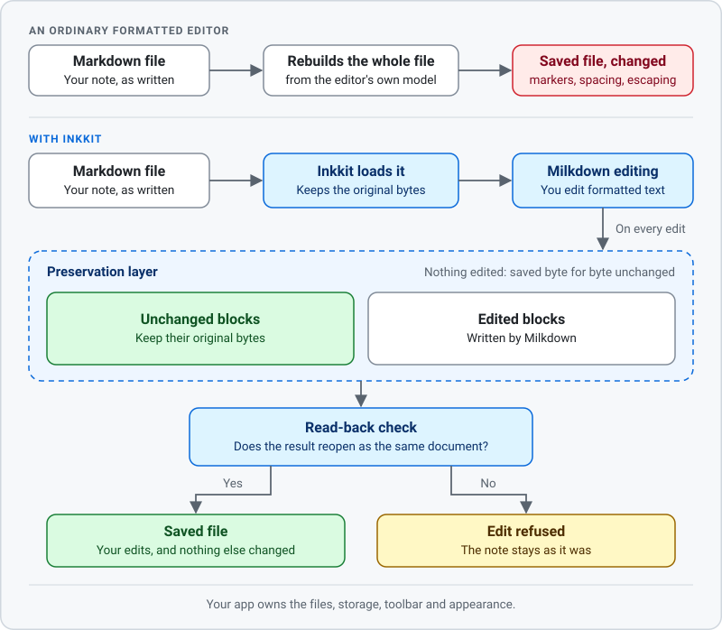

# Inkkit

A Markdown editor for web pages and for apps that host a web view. People edit formatted text, and your app saves the Markdown as it was written: an unedited document is saved unchanged, and an edit rewrites only the blocks it touches.

<details>
<summary>How Inkkit preserves Markdown</summary>

<picture>
  <source media="(prefers-color-scheme: dark)" srcset="docs/images/how-inkkit-works-dark.svg">
  
</picture>

</details>

## Get started

```sh
npm install @aicayzer/inkkit
```

```ts
import { InkKitEditor } from '@aicayzer/inkkit'
import '@aicayzer/inkkit/style.css'

const editor = await InkKitEditor.mount(document.getElementById('editor')!, {
  changed() {},
  error(error) {
    console.error(error.code, error.message)
  },
})

editor.loadDocument({
  documentId: 'note',
  generation: 1,
  format: 'md',
  text: '# Hello\n\nStart writing.\n',
})

const { text } = editor.snapshot(1)
```

## Documentation

[inkkit.cyzr.me](https://inkkit.cyzr.me) covers how Inkkit works, compatibility, integration guides and the API reference.

## License

[MIT](LICENSE). Third-party notices are in [NOTICE](NOTICE).
