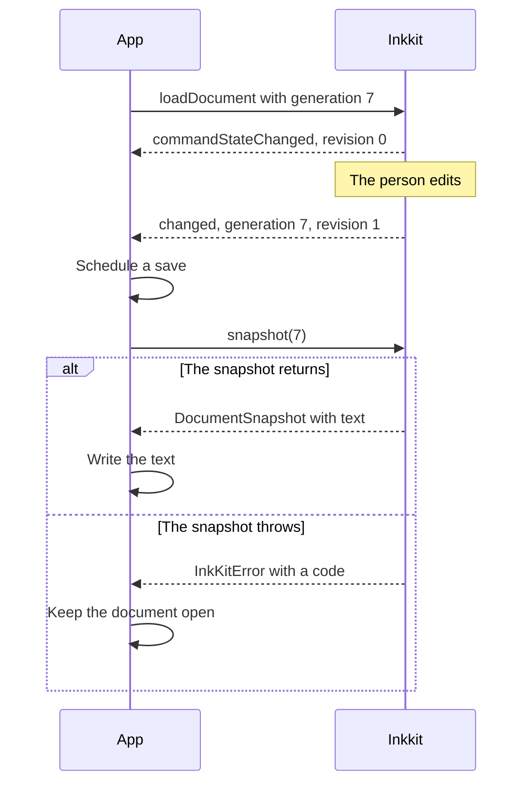

Inkkit holds one document at a time and never writes it anywhere. Your app loads the text, saves from a fresh `snapshot` when it writes, and passes the document's generation with each call, so a call meant for a document that has since been replaced fails instead of changing the new one.

## Document identity

Every load names the document with three values:

| Value        | Set by   | Meaning                                                                                                                                                                                                          |
| ------------ | -------- | ---------------------------------------------------------------------------------------------------------------------------------------------------------------------------------------------------------------- |
| `documentId` | Your app | Your name for the document, such as a path. Inkkit never interprets it. It comes back on every output and in every adapter call.                                                                                 |
| `generation` | Your app | An integer that names this load. Each load and reload must bring a greater one than the loaded document's, including a reload of identical text. The first load accepts any integer. A counter per editor works. |
| `revision`   | Inkkit   | Counts content changes within this load, from 0. A load or reload sets it to 0.                                                                                                                                  |

A generation names a load, not a file: when you open the same file again, give it a new generation. Order a document's changes by `(generation, revision)`.

Every output carries these as a `DocumentVersion` (`documentId`, `generation`, `revision`): `DocumentSnapshot`, `CommandState`, `ReadableTextSnapshot`, `Heading`, `ClipboardOutput`, `PrintableDocument`, and the values that `changed` and `commandStateChanged` receive. Adapter calls receive a `DocumentContext` with the `documentId` and `generation`, and an `operationId` for that call.

### What changes the revision

The revision increases by one for each change to the document's content: typing, paste, drop, cut, undo, redo, a successful editing call such as `format` or `replaceSource`, and typing in source mode. It is a counter, not a name for the text: undoing an edit increases it again.

These leave it unchanged: selection and caret moves, `setEditingMode`, `setEditable`, `setTextInputPreferences`, `setCommentsVisible`, `find`, reading calls such as `snapshot`, and any call that fails or edit that is refused.

## Load a document

`loadDocument(input)` replaces the document. `input` is a `DocumentInput`:

| Field        | Type              | Meaning                                                                         |
| ------------ | ----------------- | ------------------------------------------------------------------------------- |
| `documentId` | `string`          | Your name for the document.                                                     |
| `generation` | integer           | Greater than the loaded document's generation.                                  |
| `format`     | `'md'` or `'txt'` | `md` is Markdown. `txt` is literal text, with no formatted mode.                |
| `text`       | `string`          | The complete text, with its line endings. An empty string is an empty document. |

A load:

- Sets the revision to 0 and clears the undo history.
- Returns a Markdown document to formatted mode.
- Cancels pending image imports and any copy or print still in progress.
- Puts the caret at the end, takes focus off the editor's text surfaces and leaves focus in a host control where it is. It doesn't scroll to the caret.
- Sends one `commandStateChanged` and no `changed`.
- Works while the editor is read-only, and keeps editability, input preferences and the keymap as they are.

A generation that isn't greater throws `invalid-argument`. Markdown that Inkkit can't show without losing part of it throws `preservation`. Either way the load changes nothing, and the previous document stays loaded. A block that Inkkit can't build in full loads as literal source and keeps its bytes; see [Preservation](/concepts/preservation).

## Reload a changed document

`reloadDocument(input, expectedGeneration?)` loads a newer version of the document, for example after another app changed the file. It follows the same generation rule and does everything a load does, except that it keeps:

- The selection, where it still fits the new text.
- Focus and scroll position.
- Source mode, when both the old and the new text are Markdown.

A reload replaces any edits that you haven't saved, and it clears the undo history. Deciding what to do with unsaved edits when the file changes is your app's choice. Don't reload the text you just saved: saving needs nothing from Inkkit, and a reload would discard the person's undo history.

With `expectedGeneration`, the reload first checks that the loaded document is that generation and throws `stale-document` otherwise, even when the new generation isn't greater. Without it, a reload also works when no document is loaded.

## Save the document

Saving has two parts: `changed` tells you the text changed, and `snapshot` gives you the text to write.



1. **Use `changed` to schedule a save.** It fires after each change to the saved text. During one of your calls, it arrives just before the call returns, and not at all if the call fails. It doesn't fire for a load, a reload or a refused edit. A change that leaves the saved text as it was increases the revision without sending `changed`. Its value is a `DocumentSnapshot`, and its revision is the one that a snapshot taken in the handler carries.
2. **Call `snapshot(generation)` when you write.** It returns the complete current text. Write the snapshot's `text` only if the call returns.
3. **If `snapshot` throws, nothing is saved.** A failed snapshot is never an unchanged document. Don't close, switch or quit as if there were nothing to save; keep the document open.

```ts
import { InkKitError } from '@aicayzer/inkkit'

declare function writeFile(path: string, text: string): Promise<void>

/** Writes the current text. Returns false when nothing was written. */
async function save(generation: number): Promise<boolean> {
  let snapshot
  try {
    snapshot = editor.snapshot(generation)
  } catch (error) {
    if (!(error instanceof InkKitError)) throw error
    console.error('Not saved:', error.code, error.message)
    return false
  }
  await writeFile(snapshot.documentId, snapshot.text)
  return true
}
```

The snapshot's `text` is the exact source, including line endings. A document that was loaded and not edited returns the bytes that were loaded. In source mode, it includes everything typed so far.

When `snapshot` throws, its code says what to do:

| Code                | Cause                                                                   | What to do                                                                                  |
| ------------------- | ----------------------------------------------------------------------- | ------------------------------------------------------------------------------------------- |
| `composition`       | Text input, such as an IME, is composing.                               | Retry after `commandStateChanged` reports `composing: false`.                               |
| `operation-pending` | An image import is running.                                             | Retry after `commandStateChanged` reports `pending: false`.                                 |
| `stale-document`    | The generation you passed is no longer loaded.                          | Don't write. The document you meant has been replaced; don't save this text under its name. |
| `preservation`      | The current content can't be written as Markdown that reopens as shown. | Don't write. Keep the document open and tell the person it can't be saved.                  |
| `internal`          | A defect in Inkkit.                                                     | Don't write. Keep the document open and report it.                                          |

`not-ready`, `destroyed` and `invalid-argument` mean that your app called `snapshot` at the wrong time or with a bad generation. [Error codes](/reference/errors#error-codes) describes every code.

### Unsaved changes and `dirty`

A snapshot's `dirty` is `true` when its `text` differs from the text of the last load or reload. It compares text, so undoing back to the loaded text makes it `false` again.

`dirty` doesn't know about your saves: after you write a snapshot, it stays `true`. To show whether there are unsaved changes, record the `revision` of the snapshot you wrote and compare it with the revision that later `changed` events carry.

## Expected generations

Pass the generation you loaded as the last argument of every call that takes one. When the loaded document has another generation, the call throws `stale-document`, or rejects if it's asynchronous, and changes nothing. Omitted or `null` means the current generation, which suits a page with one document. An app that calls Inkkit across a native bridge should always pass it.

- **Required:** `insertText` and `keyDown`, which carry native input.
- **Optional, the last argument:** the calls that read or change the document, its selection or focus, such as `snapshot`, `commandState`, `format`, `paste`, `undo`, `printableSnapshot`, `clipboardSnapshot`, `focus` and `blur`.
- **Optional, checked only when given:** `reloadDocument`.
- **Carried by the argument:** calls that take a text range or a heading check the version that the range's `snapshotId` or the heading names.
- **None:** `loadDocument`, which brings its own generation, and editor settings such as `setEditable`, `setTextInputPreferences`, `setKeymap`, `setViewport` and `setCommentsVisible`.

[State checks](/reference/editor#state-checks) lists every member and the checks it makes.

Asynchronous work checks again when it finishes. `clipboardSnapshot`, `printableSnapshot` and `paste` reject with `stale-document` when the document is replaced while they run; `clipboardSnapshot` and `printableSnapshot` also reject when the revision or editing mode changes meanwhile. A load cancels pending image imports, and Inkkit ignores adapter results for a document that is no longer loaded. In your own callbacks, compare the `DocumentContext` you received with the document you expect before you act on a result.

After `stale-document`, don't retry with the same generation. Read the current state again and act again if the action still applies.

## Read-only mode

`setEditable(false)`, or `editable: false` at mount, stops the document from changing. The `editable` getter returns the current setting.

- **Still allowed:** selection, copying, find, navigation, folding callouts, `snapshot`, `printableSnapshot`, `clipboardSnapshot`, switching between formatted and source modes, and loading and reloading.
- **Refused:** every method that changes the document throws `read-only`, and so do `undo` and `redo`, which keep their history for when editing returns. Typing, paste, drop, cut, task toggles and image resizing don't change content.
- **When it starts:** pending image imports are canceled, and a cut still waiting for your clipboard handler removes nothing.
- **What it keeps:** the text, revision, `dirty`, selection, focus and undo history. Editability also stays as it is across loads and reloads.

`setEditable` throws `composition` while text is composing, and changes nothing. While the editor is read-only, every entry in `commandState().commands` is `false`.

## Switch and close documents

Before you load another document or destroy the editor, take a snapshot of the current one. If the snapshot throws, stay on the current document.

```ts
import { InkKitError, type DocumentSnapshot } from '@aicayzer/inkkit'

declare function writeFile(path: string, text: string): Promise<void>

let generation = 1

/** The current text, or undefined when it can't be saved now. */
function capture(): DocumentSnapshot | undefined {
  try {
    return editor.snapshot(generation)
  } catch (error) {
    if (!(error instanceof InkKitError)) throw error
    console.error('Not saved:', error.code, error.message)
    return undefined
  }
}

async function switchTo(path: string, text: string): Promise<boolean> {
  const previous = capture()
  if (!previous) return false
  editor.loadDocument({
    documentId: path,
    generation: generation + 1,
    format: 'md',
    text,
  })
  generation += 1
  await writeFile(previous.documentId, previous.text)
  return true
}

async function close(): Promise<boolean> {
  const last = capture()
  if (!last) return false
  await editor.destroy()
  await writeFile(last.documentId, last.text)
  return true
}
```

`switchTo` takes the snapshot and loads the next document without waiting in between, so no edit can land after the snapshot. If `loadDocument` throws, the previous document stays loaded. Keep the snapshot's text until your write succeeds.

`destroy()` cancels pending work and releases the editor. It resolves when the editor is gone and never rejects. Keep the root element in the page, and leave its children alone, until it resolves. Afterwards every member except `destroy` throws `destroyed`, and calling `destroy` again does nothing.
